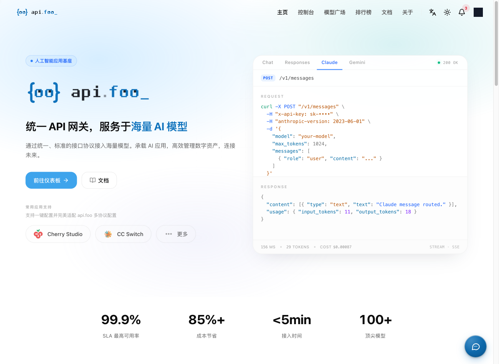
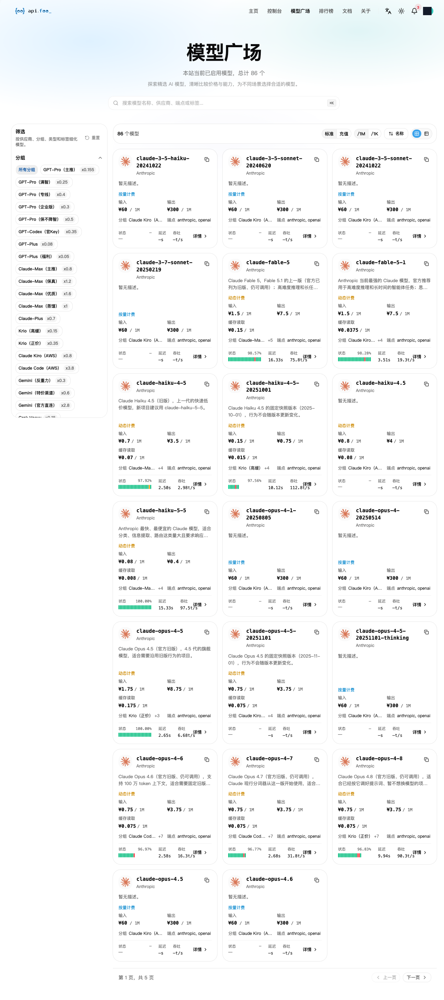
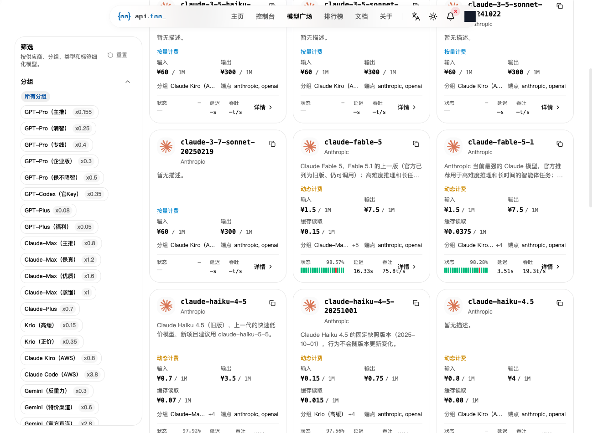

# api.foo Review: 81 Models, CNY Pricing, and Per-Call vs Per-Token Billing

api.foo lists **81 unique models across 8 vendors** — Anthropic 24, Google 24, OpenAI 14, xAI 11, DeepSeek 4, Zhipu 2, MiniMax 1, Moonshot 1. Its distinguishing choice is that the interface prices everything in **CNY** by default: ¥ per 1M tokens, or ¥ per request. If your budget is denominated in CNY, that removes a conversion step from every cost estimate.

[Open the api.foo catalog and pricing page](https://api.foo/sign-up?aff=J8aF)

> **Decision:** Choose it when you want direct CNY pricing and broad coverage — especially the 24 Claude and 24 Gemini variants. Skip it for per-second video generation, or when you only want one cheapest text model.
>
> **For:** developers budgeting in CNY, teams needing many Claude or Gemini variants  ·  **Not for:** video generation, single-model price shoppers

## How the 81 models split

| Vendor | Models | Note |
|---|---:|---|
| Anthropic | 24 | full Claude range |
| Google | 24 | full Gemini range |
| OpenAI | 14 | GPT family |
| xAI | 11 | Grok family |
| DeepSeek | 4 | Flash and Pro |
| Zhipu | 2 | GLM |
| MiniMax | 1 | M3 |
| Moonshot | 1 | Kimi |

The count comes from the live `/api/pricing` response and was verified page by page: five UI pages, 81 models each appearing once with a price. It is not the first 20 rows treated as the whole catalog.

One label trap: `81 Chat / 24 Anthropic / 24 Gemini / 11 Response / 5 Image` are **overlapping endpoint tags**. Summing them does not give a model count.

## Per-token and per-call cannot be compared directly

Of the 81 models, **71 bill per token and 10 bill per request**. Per-token means ¥ per 1M tokens; per-request means ¥ per call. Comparing the two numbers directly is meaningless — one is a token, one is a call.

Per-token examples (¥ per 1M tokens, input / output / cache read):

| Model | Input | Output | Cache read |
|---|---:|---:|---:|
| claude-fable-5-1 | 1.5 | 7.5 | 0.0375 |
| claude-opus-5-5 | 0.6 | 3 | 0.03 |
| gpt-6.1-terra | 0.05 | 0.25 | 0.0025 |
| minimax-m3 | 1.68 | 6.72 | 0.336 |

Per-request examples: `gpt-image-2` at ¥0.015 per call, `gemini-3.1-flash-image-preview` at ¥0.1 per call.

Decide the task type first — text and code go per-token, image generation goes per-call — then compare only within the same unit.

## The card price may not belong to the first group

The backend has **43 groups**, each with its own multiplier. The list view shows prices across all groups, and the first group displayed on a card plus `+N` is **not necessarily the cheapest one**.

So if you call through a specific group, the real deduction can differ from the list figure. Confirm the rate inside your own group before budgeting, rather than using the list number directly.

## Models where two pricing statements coexist

- **GPT-6.1 Terra** — the expression has two tiers, at or below 272,000 tokens and above it. The list example is not a flat rate.
- **Grok Imagine** — the group description says ¥0.05 per image while the API returns ¥3.75 per 1M for both input and output. Both values are preserved; actual deduction depends on your group.
- **Gemini Flash Image Preview** — description says ¥0.08 per image, group ratio is 0.1. Both original values kept.
- **MiniMax-M3** — the description says a 512K threshold while the expression reads `len<=521000`. A small difference, recorded rather than smoothed over.

These are not defects. They are what happens when a display price and a group-level billing expression are both exposed. Budget from the group rate.

[Confirm your group's actual rate on the live price list](https://api.foo/sign-up?aff=J8aF)

## Top-up

¥1 is enough to move funds into your account balance. Cash withdrawal goes through support: the stated rule is manual review and settlement to Alipay or WeChat within one business day, with no minimum.

## What it replaces

If you currently maintain several model accounts with separate balances and keys, api.foo consolidates them into one CNY bill. If your main need is per-second video generation, there is no such supply here — look elsewhere.

## Buying advice

Start with a small top-up that covers a few complete tasks: get the client working, check the logs, confirm the deduction. Once you know your group's real rate, scale up. A large first top-up locks budget before the pricing semantics are verified.

[Start with a small top-up and one complete call](https://api.foo/sign-up?aff=J8aF)

## Related guides

Other relay reviews on this account, by scenario:

- [TeamoRouter review](https://github.com/Ernesto90998/teamorouter-review-en) — USD pricing with per-second Seedance video, the complement to this CNY text catalog
- [Hakimi API review](https://github.com/Ernesto90998/hakimi-api-review-en) — 261 models with per-request image billing, wider coverage
- [HC gateway review](https://github.com/Ernesto90998/hc-api-review-en) — free-tier start, useful for validating demand before paying

## FAQ

### Do I need to convert from USD?

No. The interface prices in CNY by default. But group multipliers differ, so your actual deduction follows your group.

### Are all 81 models distinct?

Yes, 81 unique models. The endpoint tags are overlapping and must not be summed.

---

If this saved you a comparison pass, star the repo — pricing and group updates land here first.
